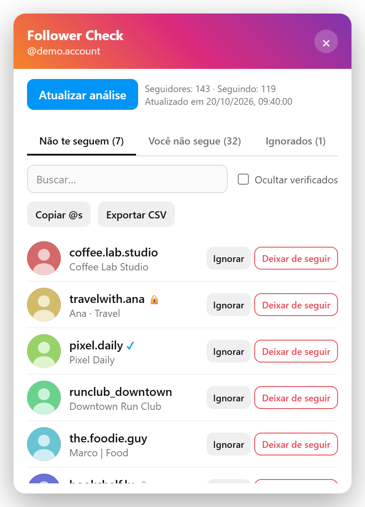

# Follower Check

[English](README.md) | **Português**

Extensão do Chrome que lista quem você segue no Instagram e não te segue de volta.

  

## Instalação

1. Abra `chrome://extensions`.
2. Ative o **Modo do desenvolvedor** (canto superior direito).
3. Clique em **Carregar sem compactação** e selecione a pasta deste repositório (onde está o `manifest.json`).

## Uso

1. Entre na sua conta em https://www.instagram.com.
2. Clique no ícone da extensão. O painel abre no canto da página.
3. Clique em **Analisar seguidores**.

O painel aparece no idioma do navegador (português ou inglês).

O painel tem três abas:

- **Não te seguem**: contas que você segue e que não te seguem de volta.
- **Você não segue**: contas que te seguem e que você não segue.
- **Ignorados**: contas que você marcou para esconder da primeira aba (artistas, marcas etc.).

Também dá para buscar, ocultar contas verificadas, copiar os @, exportar CSV e deixar de seguir direto pelo painel (pede confirmação antes).

O resultado fica salvo no navegador (`chrome.storage.local`), então dá para fechar e abrir de novo sem refazer a análise.

## Como funciona

A extensão chama a mesma API interna que o site do Instagram usa, com a sessão que já está logada no navegador:

- `GET /api/v1/friendships/{id}/following/`
- `GET /api/v1/friendships/{id}/followers/`
- `POST /api/v1/friendships/destroy/{id}/` (deixar de seguir)

Nenhum dado sai do seu navegador.

## Avisos

- O Instagram limita a quantidade de requisições. A extensão espera entre uma página e outra e pausa sozinha quando recebe um "aguarde". Em contas com milhares de seguidores, a análise pode levar alguns minutos.
- Não deixe de seguir dezenas de contas em sequência: o Instagram pode bloquear a ação temporariamente.
- A API não é oficial e pode mudar sem aviso.

## Aviso legal

Projeto pessoal e de código aberto, sem nenhuma ligação com o Instagram ou a Meta. "Instagram" é marca registrada da Meta Platforms, Inc.

A extensão usa endpoints internos e não documentados do Instagram. Automatizar o acesso ao serviço pode violar os [Termos de Uso do Instagram](https://help.instagram.com/581066165581870) e levar a bloqueios temporários ou restrições na conta. Use por sua conta e risco.

## Licença

[MIT](LICENSE)
